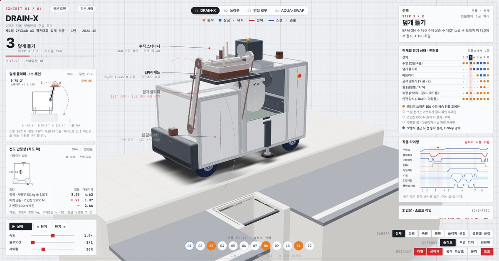

# 박세준 · 엔지니어링 전시관



직접 설계하거나 만든 로봇 4점을 3D로 돌려 보고, 단면으로 열어 보고, 작동 순서대로 움직여 보는 포트폴리오입니다.
빌드 도구 없이 HTML · CSS · JavaScript(three.js r160)로만 동작합니다.

## 전시

| 번호 | 작품 | 모델을 만든 기준 |
|---|---|---|
| 01 | **DRAIN-X** — 2035 자율 빗물받이 준설 로봇 (제2회 ZYXCAD AX 경진대회 설계 부문, 1인) | 제출 도면 S01~S06의 좌표를 만든 계산 코드의 치수 |
| 02 | **쓰리봇** — 빗물받이 덮개 개폐 시제품 (예비창업패키지 딥테크 우수기업) | 시제품 사진, 펌웨어 시퀀스(app_sequence.c), ROS2 하드웨어 문서 |
| 03 | **면접훈련 로봇** — InMoov i2Head 얼굴 서보 구동 (한이음 ICT) | 하드웨어 구성 기록(서보 17, Mega + PCA9685, 자석 28) |
| 04 | **AQUA-SWAP** — 액침냉각 데이터센터 서버 교체 로봇 (2026 3D 디자인 공모전) | 작품설명서 치수와 Fusion 렌더 |

## 보는 방법

- **재생**: 실행 / 정지, 단계 이동, 속도(0.25~4×), 슬로모션(1/1~1/20), 사이클 스크럽. 모든 부품과 도표가 같은 위상 하나로 움직입니다.
- **도표**: 오른쪽 작동 타이밍 차트를 끌면 그 시점으로 이동합니다.
- **카메라**: 전체 · 정면 · 측면 · 평면 · 근접. 근접 보기는 재생 속도를 자동으로 늦춥니다.
- **단면**: 솔리드 · 투명 외피 · 반단면 (잘린 면은 해칭으로 표시).
- **표시**: 라벨 · 상태색 · 동작 화살표 · 분리 · 도표.
- **부품**: 아래 띠나 모델에서 부품을 누르면 부품 카드가 열리고, ‘분리’를 켜면 그 부품과 연결 부품만 남습니다.
- **키보드**: 스페이스 재생/정지 · ←/→ 단계 · `,` `.` 미세 이동 · H 패널 숨기기 · L 라벨 · I 분리 · 1~6 카메라 · Esc 선택 해제

## 폴더

```
index.html              대시보드 뼈대
css/style.css           회색 기술 도판 디자인 (데스크톱 · 태블릿 · 휴대폰)
js/main.js              상태 · 라우팅(#drainx 등) · 공통 위상 루프
js/core/stage.js        렌더러, 스튜디오 반사, 접촉 그림자, 카메라 전환, 선택, 단면 · 투명 · 분리
js/core/labels.js       모델과 패널을 피하는 지시선 라벨
js/core/ui.js           제목 블록, 패널, 부품 띠, 재생 · 보기 제어, 캔버스 도식 도구
js/core/kit.js          전시 공용 도구 (효과 링, 화살표, 타이밍 차트, 부품 카드)
js/core/geo.js          형상 도우미 (압출 프로파일, 스프로킷, 키프레임 트랙)
js/exhibits/*.js        전시 4점 (모델 · 작동 · 도표 · 라벨)
js/data/about.js        만든 사람 시트
vendor/three/           three.js r160 (MIT)
assets/drawings/        DRAIN-X 원본 도면 6장
```

## 로컬에서 보기 · 배포

```
python3 -m http.server 8000   # → http://localhost:8000
```

정적 파일 그대로 배포합니다. Vercel이면 저장소를 Import하고 Framework Preset `Other`, Build Command 비움으로 Deploy하면 됩니다.

## 표기

- 화면의 수치는 각 작품의 제출 문서 값입니다. 작동 시간 축과 Z 인장 곡선처럼 움직임을 설명하려고 그린 도식에는 `SCHEMATIC` 또는 ‘도식’이라고 적었습니다.
- DRAIN-X의 `*` 표시는 현장 실측으로 확정할 설계 가정(Concept Design Assumption)입니다.
